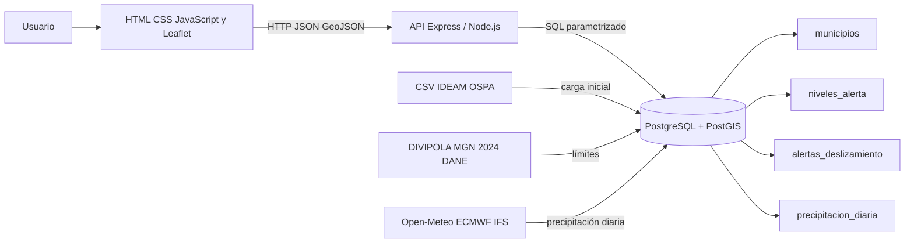

# Quindío en Alerta

Visor SIG web para explorar las alertas municipales de deslizamiento publicadas por IDEAM y contrastarlas con precipitación diaria histórica estimada para los municipios del Quindío.

## Alcance y datos

- **Área:** los 12 municipios del departamento del Quindío.
- **Alertas:** desde el 1 de enero de 2026 hasta la última fecha común disponible con precipitación histórica. El cargador deja siete días de margen para respetar el retraso del archivo meteorológico.
- **Alertas IDEAM:** CSV diario de la Oficina del Servicio de Pronósticos y Alertas (OSPA), con código DANE, municipio, categoría de amenaza, acumulados de lluvia a 3 y 10 días, días con lluvia y fecha de ejecución. Categorías: baja, moderada y alta.
- **Límites municipales:** servicio DIVIPOLA / Marco Geoestadístico Nacional 2024 del DANE. Las geometrías se descargan en EPSG:4326 para guardarlas en PostGIS y usarlas en Leaflet.
- **Precipitación diaria:** Open-Meteo Historical Weather API, variable `precipitation_sum`, modelo ECMWF IFS de aproximadamente 9 km, consultada en un punto interior de cada municipio. Es una estimación modelada en cuadrícula, no una medición directa de pluviómetro. La precipitación ayuda a comparar patrones, pero no demuestra causalidad.

Fuentes:

- [IDEAM — datos abiertos de alertas de deslizamiento](https://ideam.gov.co/transparencia/datos-abiertos/seccion-de-datos-abiertos/alertas-de-deslizamientos)
- [CSV diario de IDEAM OSPA](https://bart.ideam.gov.co/ospa/DatosAbiertos/Alertas_Deslizamientos/alertas_deslizamientos.csv)
- [DANE — DIVIPOLA MGN 2024, servicio de municipios](https://geoportal.dane.gov.co/mparcgis/rest/services/Divipola/Serv_DIVIPOLA_MGN_2024/FeatureServer/317)
- [Open-Meteo — Historical Weather API](https://open-meteo.com/en/docs/historical-weather-api)

## Arquitectura



## Modelo relacional

| Tabla | Contenido | Claves y relación |
|---|---|---|
| `municipios` | Código DIVIPOLA, nombre, área y polígono municipal | PK `codigo_dane`; geometría `Geometry(4326)` |
| `niveles_alerta` | Catálogo de niveles baja, moderada y alta | PK `nivel` |
| `alertas_deslizamiento` | Fecha, nivel y acumulados de lluvia de cada alerta IDEAM | PK `id`; FK a `municipios` y `niveles_alerta`; único por municipio-fecha |
| `precipitacion_diaria` | Precipitación diaria estimada por ECMWF IFS y municipio | PK compuesta municipio-fecha; FK a `municipios` |

Las geometrías DANE se descargan en EPSG:4326. El visor no calcula distancias; su operación espacial usa `ST_Covers` para determinar si un punto del mapa cae dentro de un polígono municipal. Los índices GiST y B-tree se crean en `db/schema.sql`.

## Funcionalidades y endpoints

1. **Mapa de alertas:** consulta GeoJSON en PostGIS y simboliza cada municipio por su alerta más reciente dentro del periodo — `GET /api/alertas`.
2. **Consulta de atributos:** selección del municipio con su área, alertas, acumulados IDEAM y serie de precipitación — `GET /api/municipios/:codigo`.
3. **Consulta espacial:** clic en el mapa; PostGIS identifica el municipio que contiene el punto mediante `ST_Covers(geom, ST_SetSRID(ST_MakePoint(lon, lat), 4326))` — `GET /api/espacial?lon=...&lat=...&fecha=AAAA-MM-DD`.
4. **Comparación lluvia-alerta:** gráfico de precipitación diaria estimada por ECMWF IFS y ficha de acumulados a 3 y 10 días que publica IDEAM. El resumen agregado se consulta en `GET /api/resumen`.

También están disponibles `GET /api/config` (fechas y conteos) y `GET /api/health` (conexión y versión PostGIS).

## Requisitos

- Node.js 20 o superior (desarrollado con Node.js 26).
- PostgreSQL 16 con PostGIS 3.5 o compatible.
- Conexión a internet para descargar las fuentes públicas al sembrar la base y para mostrar el mapa base y Leaflet.

## Instalación y ejecución

1. Crear una base nueva en PostgreSQL, por ejemplo `tarea3_deslizamientos_quindio`.
2. Copiar `.env.example` como `.env` y definir los datos de conexión. No publiques `.env` ni credenciales.
3. En la carpeta del proyecto, ejecutar:

   ```powershell
   npm.cmd install
   npm.cmd run db:init
   npm.cmd run db:seed
   npm.cmd start
   ```

4. Mantener abierta la terminal mientras se usa el visor y abrir [http://127.0.0.1:8000](http://127.0.0.1:8000).

`db:init` habilita PostGIS y crea tablas e índices. `db:seed` descarga el CSV oficial de IDEAM, los polígonos DANE para el departamento 63 y las series diarias ECMWF IFS, y carga todo en PostgreSQL. El intervalo se recalcula al sembrar: comienza el 1 de enero de 2026 y termina siete días antes de la fecha de ejecución para alinear la precipitación histórica.

## Recorrido verificable de una operación

El usuario hace clic en un municipio del mapa. Leaflet solicita `GET /api/municipios/63001?desde=2026-01-01&hasta=2026-11-11`. Express valida fechas y pasa parámetros separados mediante el paquete `pg`. PostgreSQL une `municipios`, `alertas_deslizamiento`, `niveles_alerta` y `precipitacion_diaria`; la API devuelve atributos e historial JSON y el navegador dibuja el gráfico. Para un punto cualquiera del mapa, `/api/espacial` ejecuta `ST_Covers` en PostGIS y devuelve el municipio, la alerta y la precipitación de esa fecha.

## Verificación técnica

- [Consulta SQL independiente](docs/verificacion-sql.sql) para contrastar conteos, fechas, integridad, SRID y `ST_Covers`.
- El endpoint `/api/health` muestra la base conectada y la versión de PostGIS.
- El navegador muestra `/api/alertas` como GeoJSON y representa los polígonos mediante Leaflet.
- La evidencia SQL generada está en `evidencias/consulta-sql.txt`.
